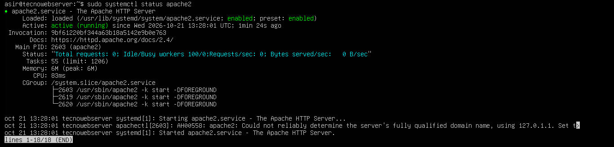
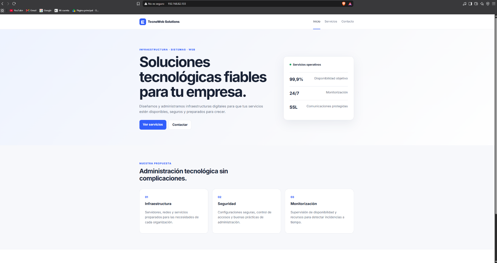
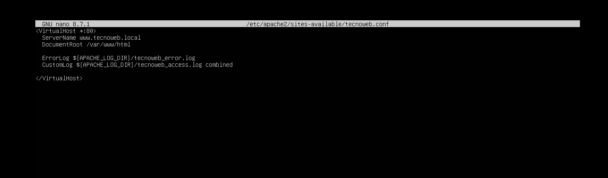
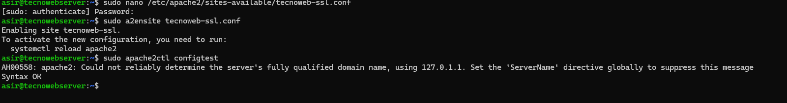
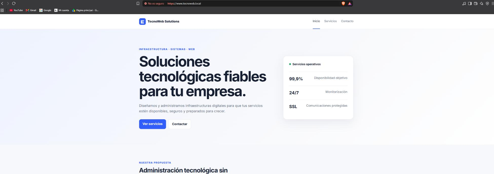
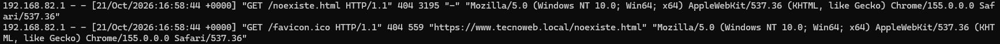

# Despliegue y administración de un servidor web Apache2 en Ubuntu Server

**Proyecto académico de ASIR | Administración de sistemas, redes y fundamentos de seguridad web**

## Resumen

En este laboratorio desplegué un sitio web para la empresa ficticia **TecnoWeb Solutions** utilizando **Ubuntu Server 26.04.1 LTS** y **Apache2** en una máquina virtual de VMware Workstation Pro. Configuré el acceso desde un equipo Windows mediante un nombre de dominio local, habilité HTTP y HTTPS con un certificado autofirmado y consulté los registros de Apache para comprobar solicitudes y diagnosticar errores.

> **Alcance:** laboratorio académico en red local. El dominio `www.tecnoweb.local` no es un sitio público. El certificado autofirmado permite probar TLS, pero no ofrece confianza automática en el navegador.

## Tecnologías

- Ubuntu Server 26.04.1 LTS
- VMware Workstation Pro (máquina virtual de 3 GB RAM, 1 CPU, 20 GB de disco y red NAT)
- Apache HTTP Server (`apache2`)
- HTTP, HTTPS/TLS, TCP/IP
- SCP sobre SSH para transferir archivos desde Windows
- Virtual Hosts, archivo `hosts`, OpenSSL y registros de Apache

## Objetivos

1. Preparar una máquina virtual Ubuntu Server y comprobar su configuración de red.
2. Instalar Apache2 y verificar el estado del servicio y su escucha en el puerto 80.
3. Transferir y publicar una página web en `/var/www/html`.
4. Configurar un Virtual Host y el nombre local `www.tecnoweb.local`.
5. Habilitar HTTPS mediante un certificado autofirmado y comprobar la escucha en el puerto 443.
6. Consultar registros de acceso y errores y comprobar el registro de una solicitud HTTP 404.

## Desarrollo

### 1. Preparación del entorno

Creé una máquina virtual Ubuntu Server en VMware Workstation Pro, con conectividad NAT. Revisé la versión del sistema, el nombre del equipo y las interfaces de red:

```bash
cat /etc/os-release
hostname
ip a
```

### 2. Instalación y administración de Apache2

Actualicé la información de paquetes, instalé Apache2 y comprobé su estado, el inicio automático y la escucha HTTP:

```bash
sudo apt update
sudo apt install apache2
sudo systemctl status apache2
systemctl is-enabled apache2
sudo ss -tlnp | grep ':80'
```

También practiqué detener e iniciar el servicio utilizando `systemctl`.

### 3. Publicación del sitio web

Transferí los archivos de la web desde Windows a Ubuntu Server mediante **SCP** y los ubiqué en `/var/www/html`.

Durante el despliegue apareció un error **403 Forbidden** relacionado con el acceso a los archivos/directorios del sitio. Revisé y ajusté permisos hasta poder mostrar la página. 
### 4. Dominio local y Virtual Host HTTP

Configuré la resolución local de `www.tecnoweb.local` mediante el archivo `hosts` y creé un Virtual Host en:

```text
/etc/apache2/sites-available/tecnoweb.conf
```

La configuración incluía `ServerName`, `DocumentRoot` y archivos de registro específicos de accesos y errores. Habilité el sitio con:

```bash
sudo a2ensite tecnoweb.conf
```

Comprobé desde Windows el acceso a la web mediante HTTP y el nombre de dominio local.

### 5. Habilitación de HTTPS

Activé el módulo SSL, comprobé la sintaxis de configuración y la carga del módulo:

```bash
sudo a2enmod ssl
sudo apache2ctl configtest
sudo apache2ctl -M | grep ssl
```

Preparé `/etc/apache2/ssl` para el certificado y la clave privada de un **certificado autofirmado generado con OpenSSL**. También configuré un Virtual Host HTTPS, recargué Apache y comprobé que atendía conexiones en el puerto TCP 443. La web se verificó desde un navegador Windows.

### 6. Registros y diagnóstico

Consulté los archivos de registro ubicados en `/var/log/apache2/`, incluidos los registros separados de acceso y errores para HTTP y HTTPS. Para examinar las últimas peticiones HTTPS utilicé:

```bash
sudo tail -n 10 /var/log/apache2/tecnoweb_ssl_access.log
```

Realicé una solicitud deliberada a una página inexistente:

```text
https://www.tecnoweb.local/noexiste.html
```

Apache devolvió **404 Not Found** y localicé la petición en el log de acceso. El laboratorio también incluyó un incidente **403 Forbidden** relacionado con permisos durante la publicación del sitio.

## Evidencias del laboratorio

Capturas extraídas **de mi propia práctica**. Están organizadas por fases y muestran únicamente resultados que aparecen en el PDF original. Algunos pasos (por ejemplo, el comando exacto de transferencia SCP o la comprobación de escucha en el puerto 443) constan en el informe, pero no tienen una captura independiente.

| Fase | Evidencia |
| --- | --- |
| Configuración VM VMware | [Ver captura](capturas/01-vm-vmware.png) (pág. 3 del informe) |
| Sistema Ubuntu, hostname e IP | [Ver captura](capturas/02-ubuntu-sistema-red.png) (pág. 4 del informe) |
| Apache2, estado del servicio | [Ver captura](capturas/03-apache-estado.png) (pág. 5 del informe) |
| Inicio automático de Apache2 | [Ver captura](capturas/04-apache-inicio-automatico.png) (pág. 6 del informe) |
| Escucha en puerto TCP 80 | [Ver captura](capturas/05-apache-puerto-80.png) (pág. 6 del informe) |
| Página inicial Apache | [Ver captura](capturas/06-pagina-apache-inicial.png) (pág. 6 del informe) |
| Web TecnoWeb publicada | [Ver captura](capturas/07-web-publicada.png) (pág. 7 del informe) |
| Resolución local en hosts | [Ver captura](capturas/08-hosts-dominio-local.png) (pág. 8 del informe) |
| Virtual Host HTTP tecnoweb.conf | [Ver captura](capturas/09-virtualhost-http.png) (pág. 8 del informe) |
| Web con dominio local HTTP | [Ver captura](capturas/10-web-dominio-http.png) (pág. 9 del informe) |
| Certificado y clave: listado sin contenido | [Ver captura](capturas/11-certificado-ssl-archivos.png) (pág. 9 del informe) |
| Habilitación del Virtual Host HTTPS | [Ver captura](capturas/12-habilitacion-virtualhost-https.png) (pág. 10 del informe) |
| Acceso HTTPS en navegador | [Ver captura](capturas/13-web-https-navegador.png) (pág. 10 del informe) |
| Logs de acceso de Apache | [Ver captura](capturas/14-registros-acceso-apache.png) (pág. 12 del informe) |
| Registro de solicitud HTTP 404 | [Ver captura](capturas/15-registro-solicitud-404.png) (pág. 13 del informe) |

### Capturas destacadas

**Apache2: estado del servicio**



**Web desplegada**



**Configuración Virtual Host HTTP**



**Habilitación HTTPS**



**Acceso HTTPS desde Windows**



**Log de solicitud 404**



> **Nota de seguridad:** el listado de certificados de la captura 11 no incluye el contenido de la clave privada. En la captura aparecen permisos de lectura amplios para el archivo `.key`; como mejora de seguridad del laboratorio, deben restringirse al administrador. No se incluye esa clave en el repositorio.

## Aprendizajes

Este proyecto reforzó mis conocimientos sobre administración de Linux, despliegue de servicios web, resolución local de nombres, Virtual Hosts, transferencia segura de archivos, certificados TLS de laboratorio y análisis de logs para diagnosticar incidencias.

## Autor

**Eduardo Medialdea Dominguez**  
Estudiante de Administración de Sistemas Informáticos en Red (ASIR), ILERNA.

---
Seguridad: El proyecto se desarrolló en un entorno de laboratorio. Las direcciones IP utilizadas pertenecen a una red privada y no se incluyen contraseñas ni claves privadas.
*Documentación propia basada en una práctica académica. No se publican datos privados, claves ni material docente sin autorización.*
